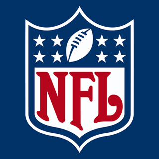

# ioBroker.nfl

## Description

ioBroker adapter that fetches NFL team information, live scores, and scoreboard data from public ESPN APIs and exposes them as ioBroker objects and files.

## Features

### Currently available (work in progress)

* Load the NFL team list from ESPN
* Download and store selected team logo variants in the adapter file store
* Create an ioBroker object tree under `nfl-teams.{espnTeamId}.*` (team info, colors, logos; slug is a state, not the folder key)
* Enrich teams with division and venue data (including venue images) where available
* Periodic scoreboard polling (ESPN CDN) writing `nfl-games.current.{eventId}.*` (live scores, clock, status, home/away)
* Season archive under `nfl-games.archive/all|{favorites}/{seasonYear}/…` with configurable retention (N seasons or unlimited)
* Stable DIY datapoints under `views.*` (flat slots + optional JSON mirrors; `views.byTeam.{id}.focus` for every team; `views.favorites` only if favorites are configured)
* Configurable live refresh interval (admin, default 30 s; auto 5 min when no games are live)
* Favorite team selection in admin (multi-select); `isFavorite` flag on each team object and on home/away per game
* **VIS-1 widget — NFL Scoreboard** (`tplNflScoreboard`): live/upcoming/all modes, favorite-filter, team logos (ESPN CDN), animated live indicator, dark-theme; auto-refreshes every 31 s
* **VIS-1 widget — NFL Favorite Team** (`tplNflFavoriteTeam`): single-team card showing live score + clock, next game countdown, or last result

### Not implemented yet

* Multi-week schedule endpoint / `schedule/` tree (Scoreboard + `current/` show the ESPN week slate only)
* VIS-2 widgets (optional future add-on)

## Requirements

* Node.js `>= 18` (see `package.json` `engines`)
* js-controller `>= 5.0.19`
* admin `>= 6.17.13`
* Optional: `vis` (VIS-1 widgets included; not required for object data alone)

## Configuration

| Setting | Default | Range | Description |
|---|---|---|---|
| **Favorite teams** | _(none)_ | any | Dropdown loads the current team list from the running adapter each time you open it. Select favorites, then use **Save**. |
| **Live scoreboard refresh interval (s)** | `30` | 15–300 | Poll interval while games are live; 5 min when idle. |
| **Seasons to keep in archive** | `2` | 0–20 | Last N ESPN season years under `archive/`. **`0` = unlimited**. |
| **Archive all / favorite games** | on / on | — | Store completed games under `archive/all` and/or `archive/favorites`. |
| **Keep finished games in current (h)** | `12` | 0–168 | Linger in `nfl-games.current` after leaving the slate before archive. |
| **Favorite focus: show final (h)** | `24` | 0–168 | How long `views.byTeam.{id}.focus` stays on `final` before next upcoming. |
| **Max today/live view slots** | `16` | 1–32 | Cap for numbered slots. Slots exist only while games fill them (no empty placeholders). |
| **Also write JSON view mirrors** | on | — | Extra JSON states for scripts; flat states are always written. |
| **Store logo base64 in objects** | off | — | Off recommended; logos remain files + CDN URLs for VIS. |

### Object paths for DIY VIS

Prefer stable views (paths do not move when a game is archived):

* `nfl.0.views.byTeam.{espnTeamId}.focus.*` — upcoming / live / final for **every** team (stable path)  
* `nfl.0.views.today.0` … — today's games as numbered slots  
* `nfl.0.views.live.0` … — live games only  
* `nfl.0.views.favorites.*` — only present when at least one favorite team is set  

Canonical week data: `nfl.0.nfl-games.current.{eventId}.*` (IDs change each week). Prefer `views.*` for DIY bindings.

## Data source

Unofficial ESPN site/core HTTP APIs (no API key). Endpoints and payloads can change without notice. This project is not affiliated with ESPN or the NFL.

## Disclaimer

The developers of this module are in no way endorsed by or affiliated with the National Football League (NFL), ESPN, or any associated subsidiaries, logos, or trademarks.
The NFL and ESPN logos used in this adapter are for illustrative purposes only and are the property of their respective owners.
If there are any concerns regarding the use of copyrighted materials in this adapter, please feel free to contact the developers, and they will promptly address them.

## Changelog
<!--
	Placeholder for the next version (at the beginning of the line):
	### **WORK IN PROGRESS**
-->

### **WORK IN PROGRESS**
* (Daniel Drießen) Games object model: `current/` + season archives + stable `views.*` (flat + JSON)
* (Daniel Drießen) Fix favorite-team admin control: use `selectSendTo` (fresh team list on open; standard Save/Close toolbar)
* (Daniel Drießen) VIS-1 widgets: NFL Scoreboard and Favorite Team card
* (Daniel Drießen) ESPN CDN scoreboard polling loop; adaptive 30s/5min intervals
* (Daniel Drießen) Favorite-team admin multi-select; `isFavorite` states on team and game objects
* (Daniel Drießen) Team folders keyed by ESPN team id; dynamic division season year
* (Daniel Drießen) Team data, logos, division/venue enrichment
* (Daniel Drießen) initial release

## License
MIT License

Copyright (c) 2024-2026 Daniel Drießen <daniel.driessen@ddproductions.de>

Permission is hereby granted, free of charge, to any person obtaining a copy
of this software and associated documentation files (the "Software"), to deal
in the Software without restriction, including without limitation the rights
to use, copy, modify, merge, publish, distribute, sublicense, and/or sell
copies of the Software, and to permit persons to whom the Software is
furnished to do so, subject to the following conditions:

The above copyright notice and this permission notice shall be included in all
copies or substantial portions of the Software.

THE SOFTWARE IS PROVIDED "AS IS", WITHOUT WARRANTY OF ANY KIND, EXPRESS OR
IMPLIED, INCLUDING BUT NOT LIMITED TO THE WARRANTIES OF MERCHANTABILITY,
FITNESS FOR A PARTICULAR PURPOSE AND NONINFRINGEMENT. IN NO EVENT SHALL THE
AUTHORS OR COPYRIGHT HOLDERS BE LIABLE FOR ANY CLAIM, DAMAGES OR OTHER
LIABILITY, WHETHER IN AN ACTION OF CONTRACT, TORT OR OTHERWISE, ARISING FROM,
OUT OF OR IN CONNECTION WITH THE SOFTWARE OR THE USE OR OTHER DEALINGS IN THE
SOFTWARE.
